<div align="center">

<a href="https://danielchen.me"></a>

<a href="https://danielchen.me"></a>

<b>Daniel Chen · 河馬 · Hippo</b><br>
Full-stack developer · Applied Data Science student · from Taiwan 🇹🇼

<a href="https://danielchen.me"></a>
<a href="https://modrinth.com/plugin/lightplus"></a>

</div>

---

### 📝 About me

```text
Started with Minecraft servers — building plugins and small tools
for a community I was part of. The tinkering never stopped, and it
eventually led me to study data science for real.

By day:     Applied Data Science student.
Any time:   web apps, small scripts, anything that makes a problem easier.
Off-screen: violin & piano, swimming, badminton, golf.
```

### 🔭 What I'm up to

- 🏡 **[Hippo's Cottage](https://danielchen.me)** — my bilingual (English / 繁中), hand-drawn portfolio built with Astro + React
- 🧰 **[ToolBox](https://tool.danielchen.me)** — a collection of useful tools for me and the community *(coming soon)*
- 💡 **[LightPlus](https://modrinth.com/plugin/lightplus)** — a Minecraft plugin that makes light blocks usable in survival
- 🧠 **Tetris AI** — a PyTorch DQN on a Tetris engine I wrote from scratch (paused, but it taught me a lot about RL)
- 🏆 2nd place — AI Medical Science Hackathon, MeDA Lab @ NTU

### 🛠 Tech Stack

**Languages**


**Frontend**


**Backend, Databases & CMS**


**Data Science**


**Infra & Hardware**


**Design**


**🌱 Currently learning**


### 📊 GitHub Stats

<p align="center">
  <a href="https://danielchen.me"></a>
</p>

### 🔗 Find me

<p align="center">
  <a href="https://danielchen.me"></a>
  <a href="mailto:hi@danielchen.me"></a>
  <a href="https://t.me/hippodev03"></a>
</p>

<p align="center">
  
</p>

<p align="center"><i>From redstone to regressions, still building.</i></p>
